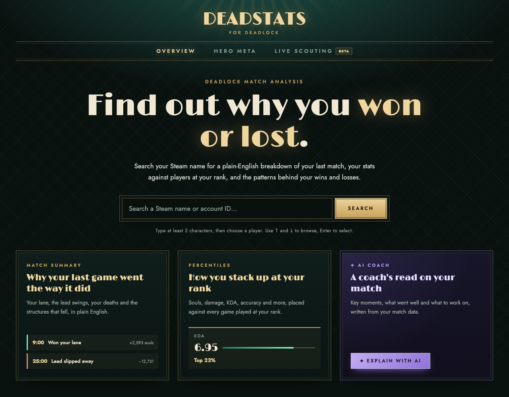
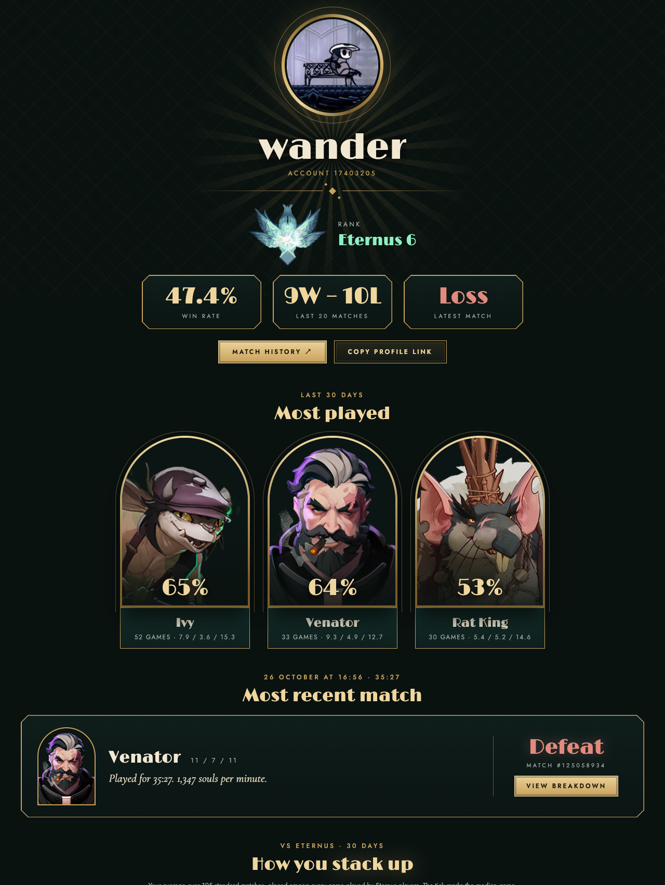
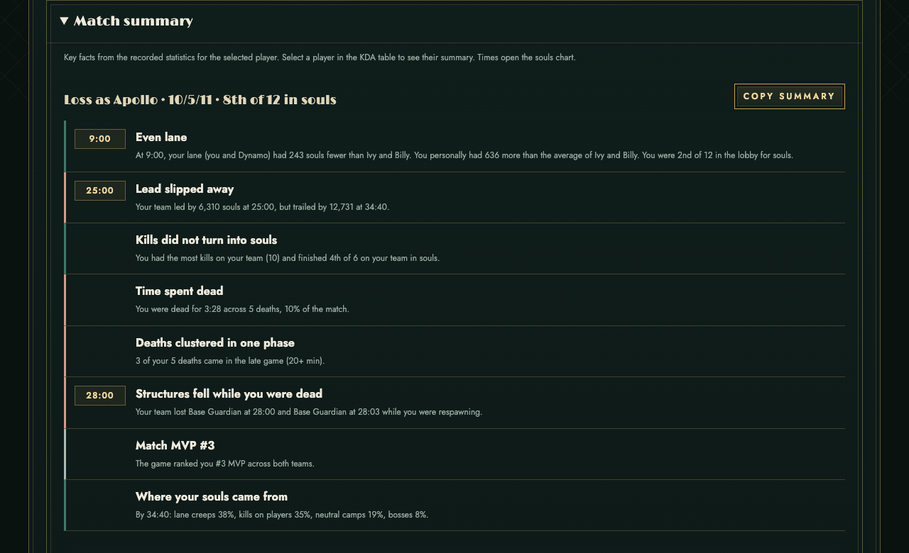
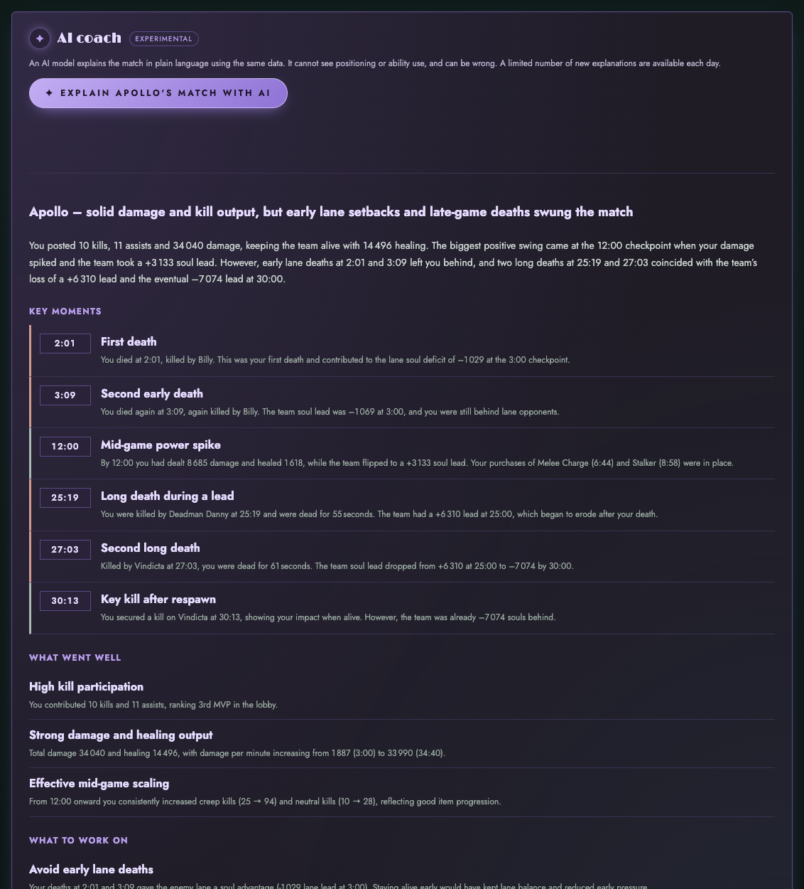
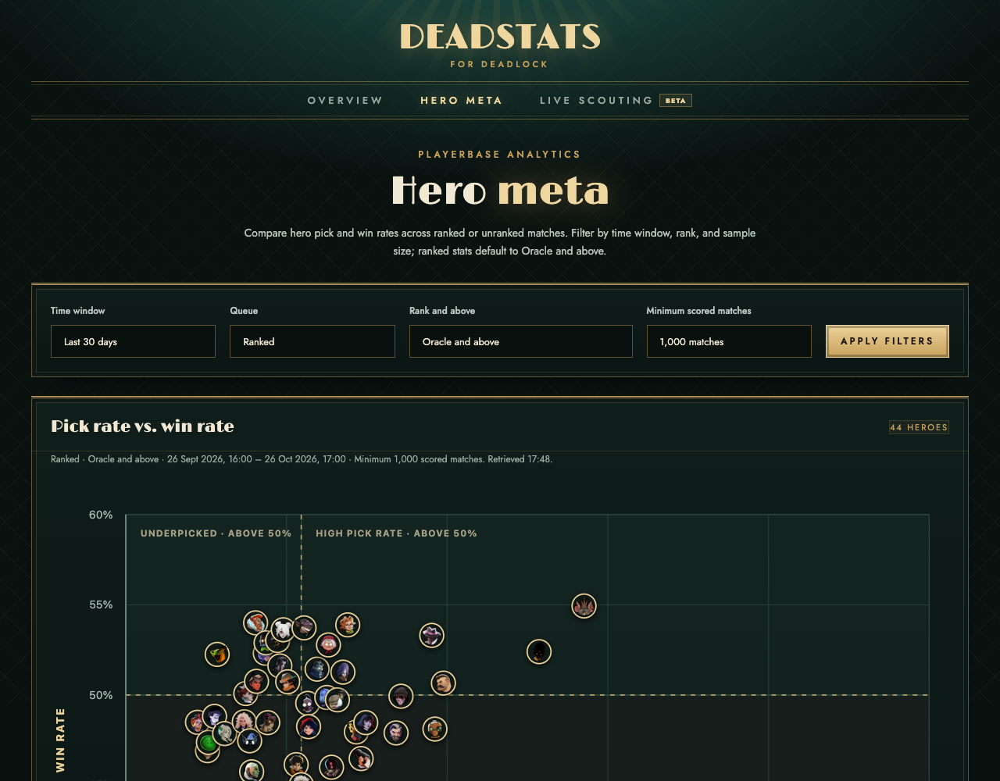
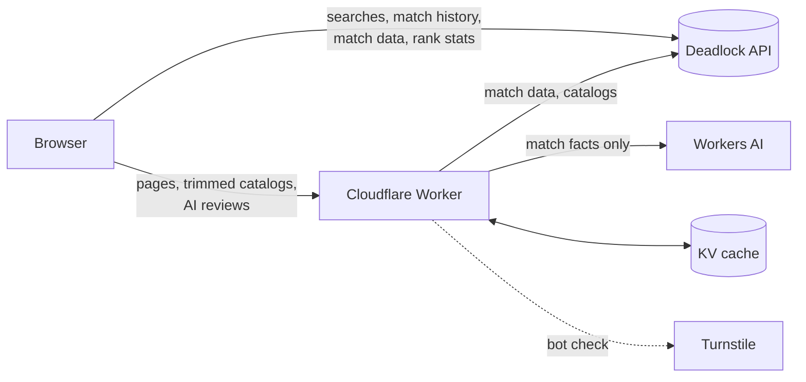

# DeadStats

[](https://github.com/AhsenUniAccount/Deadlock/actions/workflows/ci.yml)

**Find out why you won or lost your last Deadlock match.**

DeadStats is a free stats site for [Deadlock](https://store.steampowered.com/app/1422450/Deadlock/). Search a Steam name and it explains your games in plain English: how your lane went, when the lead swung, what your deaths cost, and how your stats compare with other players at your rank. An optional AI coach writes a fuller review of any match.

**Live site:** https://deadstats.ahsenjauhar.workers.dev (moving to `deadstats.org`)



## Features

- **Player profiles.** Win rate, rank, most-played heroes and the latest match at a glance, with every stat placed as a percentile against players at the same rank over the last 30 days.
- **Match summaries in plain English.** Rule-based findings for any player in any match: lane result, lead swings, time spent dead, structures lost while respawning, and where their souls came from. Every number is computed from the match data, so the summary never invents anything.
- **AI coach (experimental).** A written review of a match, with key moments, strengths and things to work on, generated from the same match data by a language model.
- **Patterns and comparisons.** What decides your games (for example, deaths in losses compared with wins), your best and worst heroes, and how you play each main hero compared with others at your rank.
- **Full match breakdowns.** Scoreboards, item builds, souls timelines for all twelve players, team advantage with objectives, lane comparisons and a kill timeline.
- **Hero meta.** Pick rate against win rate for every hero, filterable by rank, queue and time window.
- **Live scouting (beta).** Looks up the players in a live lobby and highlights likely threats.
- **Shareable.** Profile and match links unfurl in Discord, Reddit and other apps with a summary of that player's game, and summaries can be copied as text.

| Player profile | Match summary |
| --- | --- |
|  |  |
| **AI coach** | **Hero meta** |
|  |  |

## Design

An Art Deco noir look inspired by Deadlock's own occult 1920s city: deep green-black, gold double-line frames and chamfered plaques, a sunburst behind each player's emblem, Limelight display lettering, and hero portraits in gold arched windows. Hero art and rank crests come straight from the Deadlock API's asset library. Loading is designed too: gold shimmer skeletons stand in for each section, then content rises in, and everything respects the browser's "reduce motion" setting. Fonts are self-hosted, so the strict security policy needs no exceptions.

## How it works

DeadStats is a static website plus a small [Cloudflare Worker](https://developers.cloudflare.com/workers/). All game data comes from the community-run [Deadlock API](https://api.deadlock-api.com/docs).



- **The browser does most of the work.** Pages call the Deadlock API directly and compute everything locally: summaries, percentiles, patterns and charts. No account or sign-in is needed.
- **The Worker** serves the site and handles the few jobs a browser can't:
  - it serves trimmed hero and item catalogs (about 25 KB instead of 8 MB);
  - it generates and caches AI reviews;
  - it adds per-match link previews for chat apps.

### Numbers come from code, not the AI

Every figure the site shows is calculated by plain JavaScript from the recorded match data:

1. `match-stats.js` validates and normalizes the API's match metadata. Missing values stay `null`, never zero.
2. `match-digest.js` turns one match into facts about one player: lane opponents, souls and damage at each recorded snapshot, team and lane leads, deaths with time spent dead, objectives, purchases, and a list of what the data *can't* show (positions, ability use).
3. `match-summary.js` applies fixed rules to those facts to produce the plain-English summary.
4. For the AI coach, the Worker sends that same digest to a model, using hero names only, never Steam names. The model's job is to explain and prioritize, not to calculate. Its output is constrained to a JSON schema, and timestamps outside the match are dropped.

### Percentiles

The Deadlock API publishes per-game quantiles (1st to 99th percentile) for metrics such as souls per minute, KDA and accuracy, and can filter them by rank. DeadStats asks for the player's own averages and for the distribution at their rank tier, then places the player on that curve by linear interpolation. For deaths, lower is better, so the percentile is flipped and every percentile reads as "better than X%".

## Project structure

```
public/                 The website (static files served as-is)
  *.html                Pages: profile, match, match history, hero meta, live scouting, privacy, 404
  css/                  Deco theme (deco.css), front page and per-page styles
  fonts/                Self-hosted Limelight, Jost and Cormorant Garamond
  images/               Icons, share card and artwork
  js/core/              Data and calculations, no DOM: also used by the Worker and tests
  js/ui/                Page controllers and renderers
  _headers              Security headers for static files
worker/                 Cloudflare Worker: routing, AI reviews, previews, security
tests/                  Node test suite (node:test)
scripts/                Backtest for the live scouting model
docs/                   Technical notes, live scouting notes, screenshots
wrangler.jsonc          Worker, static assets, KV, rate limits and settings
```

The pages are plain ES modules: there's no framework and no build step.

## Running locally

You need [Node.js](https://nodejs.org/) 22 or newer.

```sh
npm install
npm run dev:offline   # site and Worker at http://127.0.0.1:8787, no Cloudflare account needed
npm test              # 89 tests: calculations, page behaviour and Worker routes
npm run check         # every import, page asset and CSS url() points at a real file
```

`dev:offline` runs everything except the AI coach. To try the AI coach locally, run `npx wrangler login` once and then `npm run dev`. Workers AI always runs on Cloudflare, so local requests count toward that account's free daily allowance.

Any static server pointed at `public/` (for example VS Code Live Server) also works for everything that doesn't need the Worker.

## Deploying your own copy

1. Run `npx wrangler login`.
2. Create a [Turnstile](https://developers.cloudflare.com/turnstile/) widget (invisible mode) for your domain. Put its site key in `public/js/ui/review-panel.js`, and its secret in the Worker:
   ```sh
   npx wrangler secret put TURNSTILE_SECRET
   ```
3. Update the site URL in the pages' canonical and share tags, `sitemap.xml` and `robots.txt`.
4. Run `npm run deploy`. On the first deploy, Wrangler creates the KV namespace; then set its ID in `wrangler.jsonc`.

Settings in `wrangler.jsonc`:

| Setting | Default | Purpose |
| --- | --- | --- |
| `ANALYSIS_PROVIDER` | `workers-ai` | `workers-ai` (free daily allowance) or `anthropic` (paid; needs an `ANTHROPIC_API_KEY` secret) |
| `ANALYSIS_MODEL` | `@cf/openai/gpt-oss-120b` | Model used for AI reviews |
| `DAILY_REVIEW_LIMIT` | `25` | New AI reviews per day across the site, sized to stay within the free allowance |
| `DAILY_IP_LIMIT` | `5` | New AI reviews per visitor per day |
| `ANALYSIS_LIMITER`, `PREVIEW_LIMITER` | 3/min, 60/min | Per-IP rate limits for AI reviews and link previews |

## Continuous integration

GitHub Actions ([`.github/workflows/ci.yml`](.github/workflows/ci.yml)) runs on every push and pull request:

1. `npm ci` from a clean checkout.
2. `npm test`: the full test suite.
3. `npm run check`: no broken file references.
4. A Wrangler dry run, which proves the Worker builds and lists the files that would be published.

On pushes to `main`, once those pass, the **deploy** job publishes to Cloudflare and then smoke-tests the live site (pages load, the catalog endpoint works, private files stay private, security headers are present). Dependabot opens weekly pull requests for npm and GitHub Actions updates, and each one goes through the same checks.

Deploys need two repository secrets (**Settings → Secrets and variables → Actions**). Until they exist, the deploy job skips with a notice and CI still runs.

| Secret | Value |
| --- | --- |
| `CLOUDFLARE_API_TOKEN` | A Cloudflare API token from the **Edit Cloudflare Workers** template |
| `CLOUDFLARE_ACCOUNT_ID` | The Cloudflare account ID that owns the Worker |

The optional repository variable `SITE_URL` sets the address for the smoke test (for example `https://deadstats.org`). Once deploys run from GitHub, deploy only through `main` rather than from a laptop, so the live site always matches the repository.

## Security and privacy

- **No accounts or tracking:** there are no sign-ins, no cookies and no analytics. Page text from the API and the AI is always inserted as text, never as HTML.
- **AI reviews can't be abused cheaply:** they only accept same-origin JSON requests, require a Cloudflare Turnstile token, and are rate-limited per IP and per day. Per-visitor counts are stored as a salted hash, never the IP itself.
- **Strict browser security:** a strict Content Security Policy and other security headers apply to every response.
- **Privacy policy:** what is processed and stored is set out in plain English in the site's [privacy policy](public/privacy.html).

## Accuracy and limitations

- **Coverage:** data comes from a community API that records most, but not all, matches. History may be incomplete or delayed.
- **Unavailable data:** the match data has no player positions, ability usage or per-kill assist credit, so DeadStats doesn't make claims about them.
- **AI coach:** it can still misstate a number or draw a weak conclusion. It's labelled experimental, and every review links to the exact data it was given.
- **Live scouting:** its threat index is in beta and hasn't been shown to predict results (see [docs/LIVE_MATCH_ANALYSIS.md](docs/LIVE_MATCH_ANALYSIS.md)).

For definitions of every statistic, API details and contributor notes, see [docs/TECHNICAL_NOTES.md](docs/TECHNICAL_NOTES.md).

## Credits

- **Match data:** the community [Deadlock API](https://api.deadlock-api.com/docs).
- **Fonts:** [Limelight](https://fonts.google.com/specimen/Limelight), [Jost](https://fonts.google.com/specimen/Jost) and [Cormorant Garamond](https://fonts.google.com/specimen/Cormorant+Garamond), under the SIL Open Font License, self-hosted from Google Fonts.
- **Disclaimer:** DeadStats is an unofficial fan project, made by Ahsen Jauhar. It is not affiliated with or endorsed by Valve. Deadlock and related names and images are trademarks of Valve Corporation.
